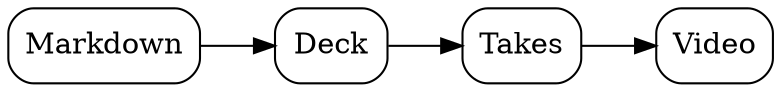
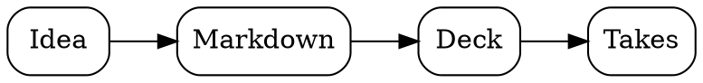
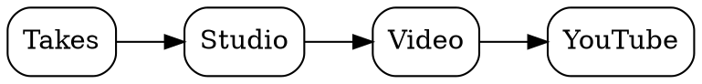

#  Slide<span class="st-take">take</span> Showcase

Everything a deck can hold, written in plain markdown and working on screen. Open **✎ Editor** to see the source of any card. Press → to walk it, **O** for the map.

## ✍️ Text

Paragraphs, **bold**, *italic*, `code`, [links](https://slidetake.com) and lists, as markdown writes them.

- One point
- Another point
  - A detail under it

### Steps

Put `<!-- steps -->` before a list and it reveals one item per press. Everything after it on the card steps too, so a closing line waits its turn:

<!-- steps -->
- First, the problem
- Then, the idea
- Finally, the result

> The conclusion comes last. `<!-- steps: off -->` ends the steps early.

### Quotes and tables

> A quote stands out from the text around it.

| Plan | Price | Users |
|---|---:|---:|
| Starter | ₹0 | 1 |
| Team | ₹499 | 10 |

### Code

```python
def take(slide):
    return slide.best_attempt()
```

### Links between cards

`{#charts}` at the end of a heading gives its card an id, and a link to `#charts` flies there: [see the charts](#charts).

## 📐 Diagrams

Write the diagram in a fenced block named after its language.

### Graphviz



### D2

```d2
direction: right
write: Write {shape: rectangle}
present: Present
record: Record
write -> present -> record: one session
```

### SVG

Drawn inline, so `currentColor` and `var(--accent)` follow the deck's colours. Press **L** and watch it switch.

```svg
<svg xmlns="http://www.w3.org/2000/svg" viewBox="0 0 320 130">
  <rect x="10" y="10" width="90" height="80" rx="10" style="fill:var(--accent)"/>
  <rect x="115" y="10" width="90" height="80" rx="10" style="fill:var(--accent);opacity:.6"/>
  <rect x="220" y="10" width="90" height="80" rx="10" fill="none" stroke="currentColor" stroke-width="2"/>
  <text x="160" y="120" text-anchor="middle" font-size="14" fill="currentColor">accent, faded, outlined</text>
</svg>
```

### One at a time

Diagrams or charts in a row after `<!-- steps -->` become a carousel: one per press.

<!-- steps -->





## 📊 Charts {#charts}

ECharts, as a fenced `echarts` block of JSON options.

### A bar chart

```echarts
{
  "xAxis": {"type": "category", "data": ["Jan", "Feb", "Mar", "Apr", "May"]},
  "yAxis": {"type": "value"},
  "series": [{"type": "bar", "data": [12, 19, 15, 24, 30]}]
}
```

### A donut

```echarts
{
  "series": [{"type": "pie", "radius": ["45%", "70%"],
    "data": [{"name": "Equity", "value": 85}, {"name": "Debt", "value": 5}, {"name": "Gold", "value": 10}]}]
}
```

## 🖼️ Images

The layout comes from what's on the slide; the alt text is the caption.

### One image


### A tall image


### Image and text


An image beside text makes a split card. Write the text first and the image moves to the right.

### A gallery

A list of images is a gallery. With `<!-- steps -->` it becomes a carousel: one image at a time, the next on each press. Diagrams and charts work the same, and after `<!-- steps -->` two or more of them in a row are a carousel without the list.

<!-- steps -->
- 
- 
- 

### A grid

Several images in one paragraph sit side by side, up to four a row:

  

### Full screen

<!-- view: full -->


## ▶️ YouTube

https://www.youtube.com/watch?v=jNQXAC9IVRw

A YouTube link alone on a line becomes the video: the next press plays it, leaving the slide pauses it.

## 🎥 Camera

<!-- camera: on, full, on -->

Try it: press **C** to turn on your camera, then →. This card puts you in the corner, then full screen, then back, from one comment: `<!-- camera: on, full, on -->`.

## 🗺️ Layouts and the map

<!-- view: overview -->

This card began by pulling back to the whole map: `<!-- view: overview -->` does that. Try it: press **1** to **4** for focus, path (the default), radial and tree, and **O** to zoom out and back.

### Progress and timer

Press **F**: in fullscreen a thin bar along the bottom fills as you go. This deck says `duration: 10m`, so a lighter clock layer grows behind it; if it shows past the fill, you're behind.

## 🎨 Colours

Try it: press **L** now. Dark and light switch, charts and diagrams included.

A deck sets its own colour with one line, `accent: "#3b82f6"`, shaded for both modes. See it in [blue](/share#deflate:ZVJNa9wwEL3rV0y1hzZGTummn6YENodCoYVCAjksC9Zak5VY1zKacXZN2Gt-QH9if0kl2aSBnPTGevPmjZ_KshTsuMUKvnewbQcUummw4wrk4mL7eXn3UYoyksTiiSBurCMw2OzBagLfIeCRg4bWRagZ2CKw7xXUL7RqBbozgPcYRrau28Gdb1t_oAo4iqisQSpLNFYHzvRUGad3Qf8-h18BiaAofhRFnAKECFvPFshqg3QenS7gmrEnIb6-KkughKEsL0UZu658a4pCwToO2tPmzVuy_tBowrM8yaI20RUB6z1OLnzrhxB7rz0YjzR5n3b1Xab0mm0krGanIa2lgx_mmlpnEEY_vA6pJRtcTdsJUdc1ZkjiQR5XR0eyggfJY48RyEYz7nwYpQJpNOv4bS1_-i7VNwOm4xZNruyQjm_Byc0pgvGF1r2O6cmTEiAJg8N0u_5_vdXh-ZT3Cj4p-KDgi4J3y81pc0peZ_NzGNm-WQrjAjbsfFfF5XeWxSE4RigvoY9hxReQYKT4YKr8XihGGOlPile62QuxTkfKNP-1ORf4-_jnWUyLKQ86E_8A), [coral](/share#deflate:ZVJNa9wwEL3rV0y1hzZGSkn6EWJKYHMoFFooJNDDsrATa7IS61pGI2fXhL32B-Qn9pdUkk0TyElvrDdv3vhJay2iiy3V8K2DxgdsBTYNdbEGubi_vPhw9lkKnVhi8cwQt9YxGGp2YJHBdwR0iAGhdQlihGgJou8VbF6JbRRgZ4AeKIzRum4L975t_Z5riElEFQ1WRaKxGGKh58o43Ab8fQo_AzFDVX2vqjQFmAjufLTAFg3xabK6gJtIPQvx5Y3WwBmD1ldCp65r35qqUrBKg3a8fveerd83yHRSJllCk1wxRNzR5MK3fgip98aD8cST92lX3xVKj9EmwnJ2GvJaGPww19w6QzD64W3ILcXgctpOiM1mQwWyeJSH5cGxrOFRxrGnBGSDkbY-jFKBNBgxfVvJH77L9e1A-fhFplR2yMfX4OT6mMD4SusB29RxVAIkU3CUb1fP13cYXk75qOBCwScFlwrOztfH9TF7nc3PYRT75lwYF6iJznd1Wn5ro9gHFwn0FfQprPQCMkwUH0xd3gunCBP9v-I1NjshVvnImZa_NucCf_88vYhpMeXBJ-If) or [violet](/share#deflate:ZVJNa9wwEL3rV0y1hzZGTmlo-mFKYHMoFFooJJDDsmCtNVmJdS2jGe-uCXvtD-hP7C-pJJt0ISe9sd68eeOnsiwFO26xgm8d7J1vkYVuGuy4Arn4tLluHj9IUUaaWJxRxL11BAabHVhN4DsEPHLQ0LoINQNbBPa9gvqFWq1AdwZwj2Fk67otPPq29QeqgKOIyhqkskRjdeBMT5Vxehv0r0v4GZAIiuJ7UcQpQIiw8WyBrDZIl9HrAu4YexLiy6uyBEoYyvJGlLHr1remKBSs4qAdrd-8JesPjSa8yJMsahNdEbDe4eTCt34IsffOg_FIk_dpV99lSq_ZRsJydhrSWjr4Ya6pdQZh9MPrkFqyweW0nRB1XWOGJJ7kcXl0JCt4kjz2GIFsNOPWh1EqkEazjt9W8ofvUn0_YDoe0OTKDun4GpxcnyIYX2jtdRs7TkqAJAwO0-3q__VGh_Mp7xV8VHCt4LOCd1fr0_qUvM7m5zCyfXMljAvYsPNdFZffWhaH4BihvIE-hhVfQIKR4oOp8nuhGGGkPyve6mYnxCodKdP81-Zc4O_vP2cxLaY86EL8Aw).

## ✂️ Record a video

Try it: press **● Studio** (top right), then **● Record**. Stumble on a slide, press ←, say it again; then pick the best take of each. Step by step: [Docs → Record a video](/docs#4-record-a-video).

## 🌐 Open from anywhere

Try it: this deck is a file on GitHub, and opens from there too: **[slidetake.com/gh/slidetake/slidetake/examples/showcase.md](/gh/slidetake/slidetake/examples/showcase.md)**. Gists, any markdown URL, and a link with the deck inside it open the same way, and `npx slidetake deck.md` opens one from your computer.

## 🚀 Start your own

Open **✎ Editor** and press **New** for a template (blank, talk or recording), or type in this deck to make it your copy.

The templates and this deck live in [examples/](https://github.com/slidetake/slidetake/tree/main/examples) on GitHub.

Next, how it all works, step by step: **[Docs →](/docs)**
